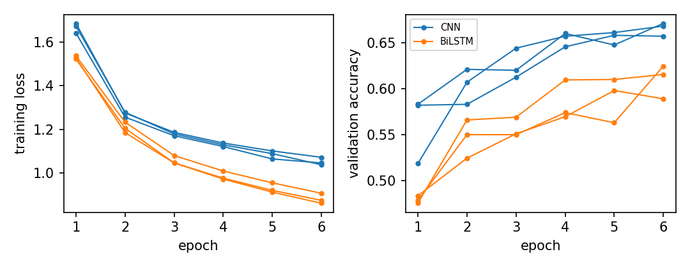
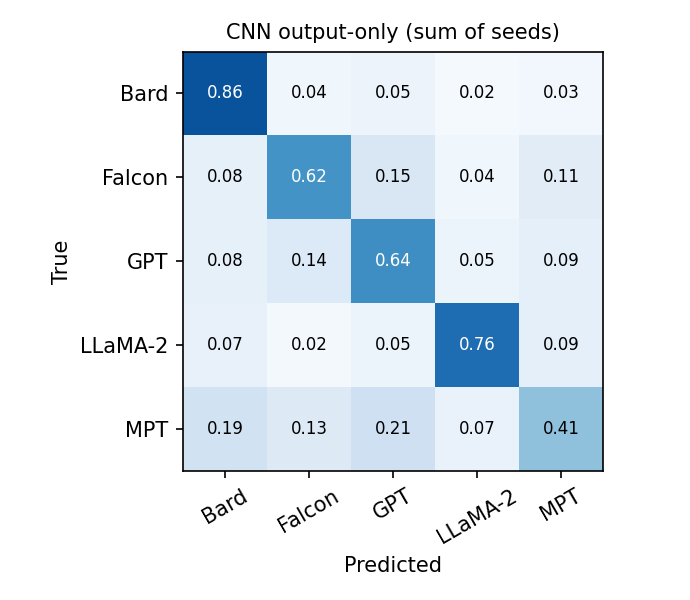
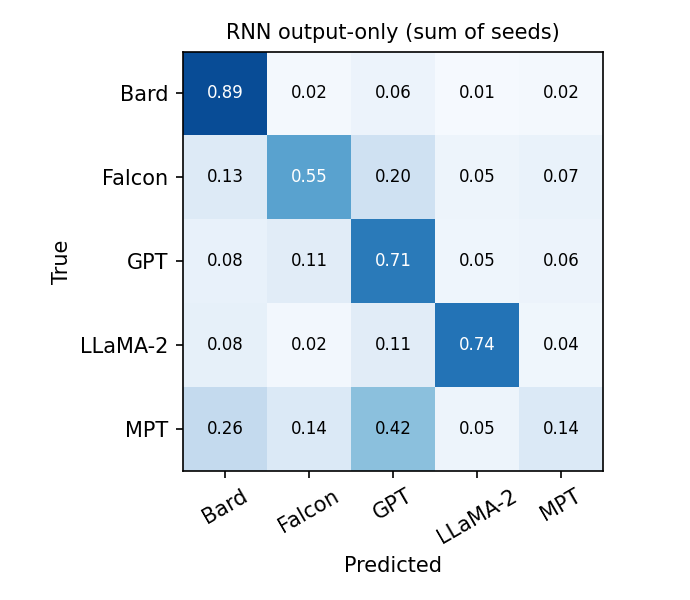
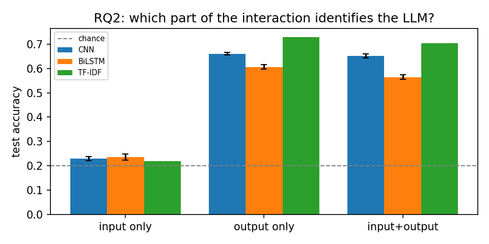
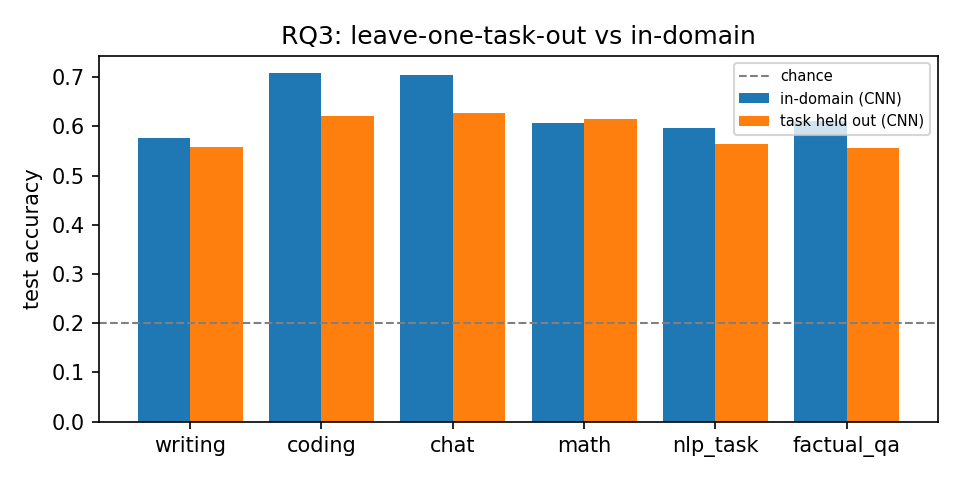
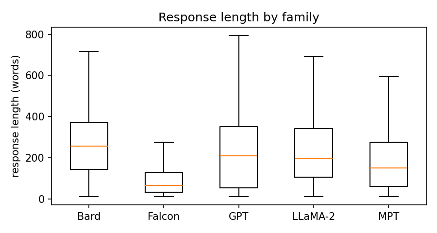
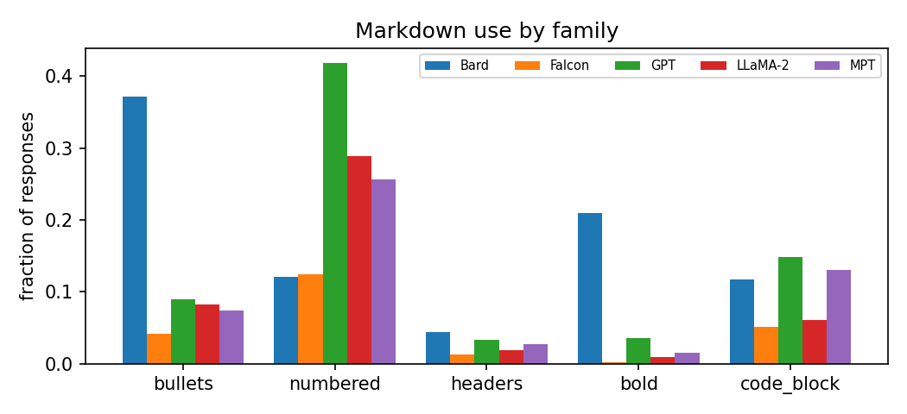
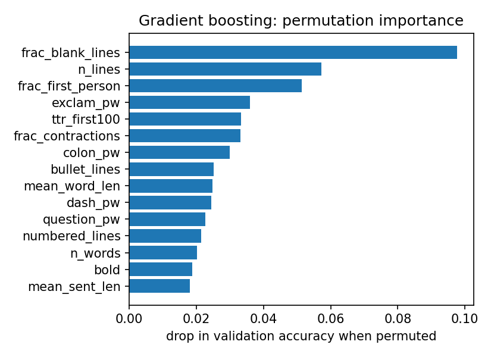
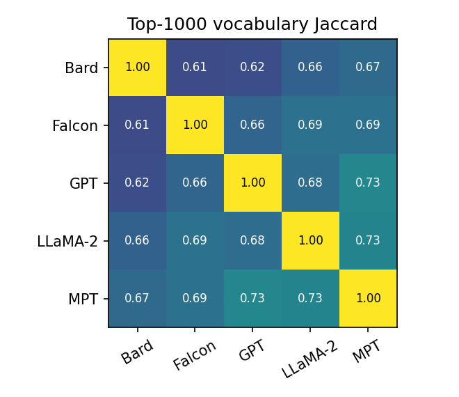

**Repository:** <https://github.com/Keshav-kh/CMPSC448-project1>. **Provenance:** every *result* number in this report (dataset counts, accuracies, F1, confidence intervals, statistics, timings) is inserted by `src/make_report.py` from `results/*.json` or `data/processed/data_stats.json`. Hyperparameters and the narrative are written by us. All 96 neural runs share one model version (`v2-padding-invariant`) and one data file (md5 `7b7eec9d`); `src/eval.py` refuses to aggregate otherwise.

# 1. Problem definition and dataset curation

**Task.** Given a response written by a large language model, predict which *LLM family* produced it. This is a 5-way text classification problem. We also ask whether the user prompt helps (RQ2), whether the learned "fingerprint" transfers across task types (RQ3), and which stylistic signals separate the families (RQ4).

**Source.** We use the public **UltraFeedback** dataset (`openbmb/UltraFeedback`, MIT licence on its dataset card; Cui et al., 2023). Each record has a prompt (`instruction`), the sub-dataset it came from (`source`: Evol-Instruct, ShareGPT, UltraChat, FLAN, TruthfulQA, FalseQA), and four completions, each tagged with the generating `model`. This gives the required (LLM_name, LLM_input, LLM_output) triples directly. The raw files contain 255,864 completions for 63,936 unique prompts from 17 models. Because every prompt was answered by four randomly chosen models, **the same prompt appears with several different labels**, which matters for RQ2. We did not query any model or collect any data ourselves. We did not audit the prompts for personal information, though. Some of them come from ShareGPT, i.e. conversations real users shared, and a dataset licence does not guarantee they are free of personal or third-party content. We use the text only for aggregate statistics and classification, and we redistribute only the processed file that the public dataset already contains.

**Family grouping.** We grouped models by developer and kept only unambiguous ones:

| family | models |
|---|---|
| GPT (OpenAI) | gpt-3.5-turbo, gpt-4 |
| LLaMA-2 (Meta) | llama-2-7b-chat, llama-2-13b-chat, llama-2-70b-chat |
| Bard (Google, predecessor of Gemini) | bard |
| Falcon (TII) | falcon-40b-instruct |
| MPT (MosaicML) | mpt-30b-chat |

We dropped third-party LLaMA fine-tunes (Vicuna, WizardLM, UltraLM, Alpaca): they share LLaMA's base weights but were tuned largely on GPT-distilled data, so assigning them to either family would blur the labels. We also dropped StarChat (a code-only model) and Pythia-12B (only 834 completions).

**Cleaning and balancing.** Starting from 124,531 completions of the kept models, we first removed **generator artifacts**. Literal end-of-sequence markers such as `</s>` appear almost only in Falcon output: 1,063 Falcon rows vs 1 row from all other families combined. Such a marker would identify the label without saying anything about style, so it is stripped. We then removed empty texts, exact duplicate responses and duplicate (prompt, model) pairs, and kept responses of 10–1000 words. 116,029 rows remained, but they were very unbalanced (LLaMA-2 49,702 vs Bard 8,266). We randomly downsampled every family to 4,000 rows, giving **20,000 examples** and 17,899 unique prompts. Finally, we shuffled the rows so that neither files nor evaluation batches are ordered by family.

**Task label.** For RQ3 we derived a task label for every prompt. TruthfulQA and FalseQA prompts become *factual_qa*. For all others we apply keyword rules on the prompt, in order: code terms give *coding*; math terms or arithmetic give *math*; remaining FLAN prompts give *nlp_task*; writing verbs (write, essay, story, email, ...) give *writing*; everything else is *chat*. These labels are heuristic and noisy.

| task | rows | Bard | Falcon | GPT | LLaMA-2 | MPT |
|---|---|---|---|---|---|---|
| writing | 2336 | 576 | 415 | 499 | 394 | 452 |
| coding | 3419 | 690 | 682 | 706 | 641 | 700 |
| chat | 7666 | 1851 | 1381 | 1634 | 1350 | 1450 |
| math | 1686 | 257 | 374 | 331 | 373 | 351 |
| nlp_task | 3731 | 258 | 974 | 622 | 1041 | 836 |
| factual_qa | 1162 | 368 | 174 | 208 | 201 | 211 |

**Split.** We split 80/10/10 *by unique prompt* (seed 448), so a prompt and all its responses fall in a single split. The code asserts that no prompt crosses splits. After downsampling, 1,880 prompts are still answered by more than one family.

| split | total | Bard | Falcon | GPT | LLaMA-2 | MPT |
|---|---|---|---|---|---|---|
| train | 16009 | 3224 | 3180 | 3176 | 3207 | 3222 |
| val | 1999 | 405 | 426 | 377 | 405 | 386 |
| test | 1992 | 371 | 394 | 447 | 388 | 392 |

**Example.** One prompt from the training split, answered by two families. Each row is one (LLM_name, LLM_input, LLM_output) triple; the input is shared. Line breaks are shown as ¶.

LLM_input: *"Construct a hyperbole that captures the color of the sunset."*

| LLM_name (family) | LLM_output |
|---|---|
| bard (Bard) | Sure. Here's a hyperbole that captures the color of the sunset: ¶  ¶ The sunset was so beautiful, it looked like someone had spilled a bucket of paint across the sky. ¶  ¶ I hope you like it! |
| mpt-30b-chat (MPT) | The sunset was a fiery explosion of colors that could make the world melt. |

Both answers do the task, but Bard opens with "Sure. Here's...", uses blank lines and closes with a friendly sign-off, while MPT gives a single plain sentence. Signals like these are what our models pick up (RQ4).

# 2. Models and training

**Tokenisation and truncation.** We use a case-preserving regex tokenizer (`\n|\w+|[^\w\s]`). Every punctuation mark is its own token and newlines become a `<nl>` token, so formatting stays visible to the models. The vocabulary is built from the training split only (minimum frequency 2, capped at 30,003 entries, including `<pad>`, `<unk>` and `<sep>`). Sequences are truncated to **256 tokens**. This truncation is substantial and differs strongly by family: 45.1% of all responses are cut off.

|  | Bard | Falcon | GPT | LLaMA-2 | MPT |
|---|---|---|---|---|---|
| median response length (tokens) | 336 | 80 | 302 | 254 | 210 |
| % longer than 256 tokens (truncated) | 64.1 | 15.2 | 54.3 | 49.8 | 42.3 |
| % longer than 64 tokens | 93.2 | 57.5 | 76.9 | 93.5 | 79.5 |

**Padding invariance.** Batches are padded dynamically. A first version of both models was *not* padding-invariant, so a prediction could depend on the other examples in its batch (Section 5). The final models guarantee that a sequence's output depends only on its own tokens. The guarantee is checked by `tests/test_invariance.py`, which compares predictions made one-by-one, in a padded batch, in a reordered batch and with extra padding (maximum logit difference below 1e-5).

**CNN.** Embedding (128-d), then three parallel `Conv1d` layers with kernel sizes 3, 4 and 5 (128 filters each, ReLU), then max-over-time pooling, concatenation (384-d), dropout 0.5 and a linear layer to 5 classes. Only convolution windows that lie *entirely* inside the real tokens enter the max-pool. 4,039,301 parameters.

**RNN (BiLSTM).** Embedding (128-d), a bidirectional LSTM (64 hidden units per direction), then masked mean pooling and masked max pooling over time, concatenated (256-d), dropout 0.5 and a linear layer to 5 classes. The backward direction runs on each sequence reversed *within its own length*, so it never reads padding before real tokens. This is equivalent to packed sequences, but faster on our CPU: 0.093 s vs 0.326 s per batch of 64 × 256 tokens (3.5× speed-up; `scripts/bench_lstm.py`). 3,940,997 parameters.

**Training.** Adam (learning rate 1e-3), cross-entropy loss, batch size 64, gradient clipping at 5. Training batches are bucketed by length. We train for at most 6 epochs with early stopping on validation accuracy (patience 2) and restore the best-validation weights before testing. Every *neural* configuration is run with seeds 1, 2 and 3, and we report mean ± standard deviation over seeds. Confidence intervals come from a **prompt-cluster bootstrap** (2,000 resamples of test prompts, not rows, because rows that share a prompt are not independent). The TF-IDF and feature baselines are single deterministic runs. The best validation epochs for output-only RQ1 runs were 6, 6, 5 (CNN) and 6, 6, 5 (BiLSTM). Several models peaked in the last allowed epoch, so they are probably under-trained. The training curves below show this. Validation accuracy rises steeply in the first three to four epochs and then flattens, while training loss is still falling at epoch 6. More epochs would probably add a little accuracy, but the curves give no sign that they would close the gap between the CNN and the BiLSTM.

{width=85%}

**Hardware.** All 96 neural runs were trained on CPU nodes of Penn State's ICDS Roar Collab cluster (one Slurm array task per run, 4 cores each; recorded devices: cpu). The mean wall-clock time of one output-only run was 1.9 min (CNN) and 2.5 min (BiLSTM). Baselines and feature analyses ran on a laptop CPU.

**Baselines.** (a) TF-IDF over word unigrams and bigrams (case-preserving, punctuation kept, sublinear tf), followed by logistic regression (C = 4). (b) Gradient boosting on 34 hand-crafted style features (RQ4).

# 3. Results

## RQ1: Can we identify which LLM generated a response?

Output-only classification on the held-out test split (1,992 responses, about 400 per family):

| model | test accuracy (%) | 95% CI (prompt bootstrap) | macro-F1 (%) | runs |
|---|---|---|---|---|
| CNN (ours) | 66.0 ± 0.5 | [64.1, 67.9] | 65.2 ± 1.1 | 3 seeds |
| BiLSTM (ours) | 60.6 ± 0.9 | [58.7, 62.6] | 57.8 ± 1.7 | 3 seeds |
| TF-IDF + LogReg (baseline) | 72.8 | [70.9, 74.6] | 73.1 | 1 (deterministic) |
| Hand-crafted features + GBoost (RQ4) | 68.4 | - | 68.5 | 1 |
| Chance (uniform) | 20.0 | - | - | - |

Both neural models are far above chance (20%): their prompt-bootstrap 95% intervals exclude it by a wide margin. The **CNN (66.0 ± 0.5%) beats the BiLSTM (60.6 ± 0.9%)**; the intervals do not overlap. The CNN is also 1.3× faster to train. The bag-of-n-grams TF-IDF baseline is stronger than both (72.8%); Section 5 discusses why. For reference, the first version of our models, which had the padding bug, scored 65.6 ± 0.5% (CNN) and 59.6 ± 1.7% (BiLSTM); fixing the bug did not lower the headline numbers.

Per-family test accuracy (recall), mean ± std over seeds:

| family | CNN | BiLSTM | TF-IDF |
|---|---|---|---|
| Bard | 85.4 ± 0.8 | 89.0 ± 1.3 | 88.1 |
| Falcon | 65.7 ± 7.4 | 55.2 ± 3.2 | 67.8 |
| GPT | 62.1 ± 10.1 | 71.1 ± 2.6 | 73.4 |
| LLaMA-2 | 80.1 ± 3.9 | 74.1 ± 1.1 | 79.4 |
| MPT | 38.7 ± 14.1 | 13.9 ± 4.8 | 56.1 |

{width=48%} {width=48%}

**Bard** is the easiest family for the CNN (85.4%), followed by **LLaMA-2** (80.1%). **MPT** is by far the hardest (38.7% with the CNN, 13.9% with the BiLSTM). The CNN sends 21.9% of MPT responses to GPT and 16.5% to Bard. The BiLSTM sends 41.8% of MPT responses to GPT, i.e. it has essentially no MPT class. This matches RQ4: MPT has no distinctive habit of its own and sits between the other families on almost every statistic. Falcon and GPT are the other frequently confused pair.

## RQ2: Does the user's prompt help identify the LLM?

The same code, vocabulary procedure and hyperparameters are used for all three setups. *Input + output* is the prompt (first 64 tokens), then `<sep>`, then the response, truncated to 256 tokens in total.

| setup | CNN acc | BiLSTM acc | TF-IDF acc | CNN F1 | BiLSTM F1 | TF-IDF F1 |
|---|---|---|---|---|---|---|
| input only (prompt) | 23.0 ± 0.9 | 23.6 ± 1.3 | 21.9 | 18.5 ± 0.4 | 18.7 ± 0.9 | 21.5 |
| output only (response) | 66.0 ± 0.5 | 60.6 ± 0.9 | 72.8 | 65.2 ± 1.1 | 57.8 ± 1.7 | 73.1 |
| input + output | 65.2 ± 0.9 | 56.4 ± 1.0 | 70.4 | 64.4 ± 0.8 | 53.0 ± 2.1 | 70.7 |

{width=75%}

**(i) Can the LLM be predicted from the prompt alone? Barely.** Input-only accuracy is 23.0 ± 0.9% (CNN), 23.6 ± 1.3% (BiLSTM) and 21.9% (TF-IDF). Prompt-cluster bootstrap 95% intervals are [21.7, 24.3], [22.1, 25.1] and [20.2, 23.7]. They exclude uniform chance (20%), but all of them include the majority-class rate of the test set (22.4%), so no input-only model is clearly better than always guessing the largest class. A small effect was expected, because UltraFeedback assigned models to prompts at random. Prompts also repeat across families: 3,865 rows share their prompt with a response from a different family, and identical inputs with different labels cannot all be classified correctly.

**Where does the small signal come from?** Almost entirely from **Bard**. Input-only recall for Bard is 59.3% (CNN) and 72.1% (BiLSTM), while no other family exceeds 26.4%. Bard has no responses in three FLAN sub-sets (NIv2, P3, FLAN-2021) and is over-represented in Evol-Instruct and UltraChat, so the prompt's *source* is informative about Bard. A logistic regression on the one-hot source alone reaches 28.1% (95% CI [26.2, 29.9]). Two controls support this explanation, though they do not prove it is the only one:

- *Bard excluded* (4 families, chance 25.0%): TF-IDF input-only accuracy is 25.4% (CI [23.3, 27.7], bootstrap p = 0.35, n = 1,621).
- *Within ShareGPT prompts only* (all five families present): 21.6% (CI [18.5, 24.9], p = 0.17).

In both cases there is no detectable input-only signal. The derived task label (21.9%) and prompt length (19.5%) carry none either. We therefore attribute the effect to the dataset's collection process, not to the LLMs. We cannot rule out smaller contributions such as topic differences that survive our controls.

**(ii) Does adding the input improve classification? No.** Input + output is 65.2 ± 0.9% vs 66.0 ± 0.5% output-only for the CNN (within seed noise), 56.4 ± 1.0% vs 60.6 ± 0.9% for the BiLSTM, and 70.4% vs 72.8% for TF-IDF. Prepending the prompt uses up part of the fixed 256-token budget, which cuts off more of the response, and the prompt tokens are mostly noise for this task.

**(iii) When could input-only work "surprisingly well"?** Whenever the data collection links prompts to models: different prompt pools per model, different system prompts, or sources with different topics. A classifier would then learn the *collection process* rather than the LLM. Our Bard/source effect is a small instance of exactly this.

# 4. In-depth analysis

## RQ3: Do LLM fingerprints generalise across tasks?

**Setup.** For each task *T* we train the CNN (3 seeds) on the training split *without any task-T rows*, early-stop on validation rows not from *T*, and test on the task-*T* test rows. Removing a task also shrinks the training set, so we add a **size-matched control**: an in-domain CNN whose training set keeps all tasks but is randomly subsampled to exactly the same size. Both models are scored on the same task-*T* test rows, so the gap between them isolates the effect of never having seen task *T*. As a larger second sample we also report the held-out model's accuracy on *all* task-*T* rows (all splits), since it never saw any of them. For *writing* and *coding* we repeat everything with the BiLSTM.

| held-out task | model | n test | in-domain (full train) | in-domain (size-matched) | task held out | Δ vs size-matched (pts) | held out, all rows of task |
|---|---|---|---|---|---|---|---|
| writing | CNN | 246 | 58.9 ± 2.3 | 56.5 ± 1.6 | 57.0 ± 2.0 | +0.5 | 58.7 ± 1.1 (n=2,336) |
| writing | BiLSTM | 246 | 57.3 ± 1.1 | 56.5 ± 1.2 | 51.9 ± 1.9 | -4.6 | 53.5 ± 0.9 (n=2,336) |
| coding | CNN | 343 | 70.1 ± 1.9 | 73.7 ± 0.7 | 61.4 ± 3.3 | -12.2 | 60.5 ± 1.2 (n=3,419) |
| coding | BiLSTM | 343 | 57.9 ± 1.7 | 54.0 ± 2.4 | 52.7 ± 0.4 | -1.4 | 52.2 ± 0.6 (n=3,419) |
| chat | CNN | 757 | 71.2 ± 0.5 | 67.7 ± 2.6 | 64.9 ± 1.1 | -2.8 | 64.2 ± 0.4 (n=7,666) |
| math | CNN | 175 | 63.2 ± 3.4 | 62.5 ± 1.7 | 61.3 ± 1.4 | -1.1 | 61.1 ± 0.5 (n=1,686) |
| nlp_task | CNN | 359 | 60.4 ± 2.0 | 59.9 ± 1.8 | 53.9 ± 2.9 | -6.0 | 55.2 ± 2.2 (n=3,731) |
| factual_qa | CNN | 112 | 56.8 ± 1.4 | 58.0 ± 1.5 | 54.2 ± 3.6 | -3.9 | 56.6 ± 2.4 (n=1,162) |

{width=75%}

Per-family accuracy of the held-out CNN on all rows of the unseen task (mean of 3 seeds, %):

| held-out task | Bard | Falcon | GPT | LLaMA-2 | MPT |
|---|---|---|---|---|---|
| writing | 85.1 | 60.6 | 53.0 | 56.8 | 31.2 |
| coding | 61.4 | 57.8 | 57.3 | 85.0 | 43.0 |
| chat | 88.9 | 49.4 | 55.6 | 84.8 | 37.7 |
| math | 76.9 | 64.3 | 58.7 | 73.8 | 34.7 |
| nlp_task | 83.5 | 59.5 | 56.7 | 69.0 | 23.2 |
| factual_qa | 67.5 | 84.5 | 17.0 | 86.2 | 25.6 |

**(i) Does performance drop on unseen tasks? It depends strongly on the task.** Measured against the size-matched in-domain control, holding a task out changes CNN accuracy on that task by -4.3 points on average. The changes range from +0.5 on *writing* to -12.2 on *coding*.

- *Writing* (one of the two examples given in the assignment) transfers essentially without loss: 57.0 ± 2.0% held out vs 56.5 ± 1.6% size-matched (+0.5 pts).
- *Coding* is the clear exception: 61.4 ± 3.3% vs 73.7 ± 0.7% (-12.2 pts). On coding the size-matched control even beats the full-train model (70.1 ± 1.9%), so seed standard deviations understate run-to-run variation and the exact size of this gap is uncertain. Measured against the full-train model the drop is still -8.6 pts, so a real coding drop remains either way.
- *The BiLSTM shows a different ordering:* writing 51.9 ± 1.9% vs 56.5 ± 1.2% (-4.6 pts), coding 52.7 ± 0.4% vs 54.0 ± 2.4% (-1.4 pts). This is a warning not to over-read single task comparisons.

Every held-out accuracy (53.9–64.9%) stays far above chance. Per-task test sets are small (112–757 rows) and seed standard deviations are 1–4 points, so differences of a couple of points are within noise. The task labels come from keyword rules, and sources are not balanced across tasks; both remain confounds.

**(ii) Are some families more consistently identifiable? Yes.** **LLaMA-2** is recognised on every unseen task (held-out recall 56.8–86.2%). Its signature is task-independent: chatty openings ("Sure, I'd be happy to help", "Hello! I'm here to...") and safety caveats. **Bard** is robust on prose tasks (85% on unseen writing, 89% on chat) but drops on coding (61%), where its bullet-and-bold layout gives way to code. **GPT** collapses on unseen factual QA (17%), where its short, plain answers resemble Falcon's and MPT's. **MPT** is weak everywhere (23–43%).

**(iii) General fingerprint or task-specific patterns? Both.** Most accuracy survives on prose-like tasks never seen in training, so part of the fingerprint is a general family style. The large coding drop and the family-specific collapses (Bard on coding, GPT on factual QA) show that another part is "how family X formats answers to task Y". RQ4 shows these formatting habits (lists, bold, code blocks) are among the strongest cues, and they are naturally task-dependent.

## RQ4: What characteristics distinguish the LLMs?

**Per-family statistics** (all 4,000 responses per family):

| statistic | Bard | Falcon | GPT | LLaMA-2 | MPT |
|---|---|---|---|---|---|
| median length (words) | 255 | 64 | 209 | 195 | 151 |
| type-token ratio, first 100 words | 0.62 | 0.76 | 0.71 | 0.68 | 0.67 |
| mean word length (chars) | 4.72 | 4.90 | 5.13 | 4.92 | 4.94 |
| % with bullet list | 37 | 4 | 9 | 8 | 7 |
| % with numbered list | 12 | 12 | 42 | 29 | 26 |
| % with **bold** | 21 | 0 | 4 | 1 | 1 |
| % with code block | 12 | 5 | 15 | 6 | 13 |
| commas per 100 words | 5.1 | 6.4 | 8.8 | 6.0 | 6.9 |
| '!' per 100 words | 0.13 | 0.37 | 0.19 | 0.80 | 0.21 |
| % opening with Sure/Certainly/Of course | 16 | 6 | 5 | 31 | 11 |
| % opening with Hello/Hi | 0 | 1 | 0 | 17 | 1 |
| % mentioning 'AI language model' | 1 | 10 | 5 | 3 | 0 |

| family | most frequent 3-word openings (share of family's responses) |
|---|---|
| Bard | "sure, here is" (5.1%); "sure, i can" (3.3%); "here is a" (2.5%) |
| Falcon | "as an ai" (2.7%); "i'm sorry, i" (1.5%); "thank you for" (1.5%) |
| GPT | "as an ai" (2.2%); "as an ai," (1.1%); "to create a" (1.0%) |
| LLaMA-2 | "sure, i'd be" (12.9%); "thank you for" (9.5%); "hello! i'm here" (8.4%) |
| MPT | "based on the" (1.5%); "sure, i can" (1.5%); "there are several" (1.3%) |

{width=48%} {width=48%}

**Vocabulary.** We compared the 1,000 most frequent lower-cased words of each family on the training split. Overlap (Jaccard similarity) ranges from Bard–Falcon (0.62) to GPT–MPT (0.73).

**A classifier on hand-crafted features only.** We built 34 features in five groups: length, lexical, markdown, punctuation and opening phrase (`src/features.py`). Logistic regression on these features reaches 55.1% test accuracy; histogram gradient boosting reaches **68.4%** (macro-F1 68.5%). To avoid tuning our interpretation on the test set, the permutation importances and group ablations below are computed on the **validation** split (all-feature validation accuracy 69.4%), and the test split is scored only once. The top permutation importances are `frac_blank_lines` (9.8 pts), `n_lines` (5.7 pts), `frac_first_person` (5.1 pts), `exclam_pw` (3.6 pts), `ttr_first100` (3.3 pts).

{width=60%} {width=38%}

Retraining gradient boosting with one feature group removed, or with only one group (validation accuracy):

| feature group | # features | val acc, this group only | val acc, without this group | Δ vs all features (pts) |
|---|---|---|---|---|
| length | 4 | 42.6 | 66.4 | -3.1 |
| lexical | 7 | 49.7 | 65.6 | -3.9 |
| markdown | 7 | 45.2 | 62.5 | -7.0 |
| punctuation | 9 | 45.7 | 64.9 | -4.5 |
| opening | 7 | 33.4 | 67.6 | -1.8 |

**Ablations on the neural models.** We re-train both neural models (3 seeds each) on transformed responses. *window64* is a control for *no_length*: it uses the same 64-token budget but keeps length information. The difference between the two therefore isolates length; the difference between *window64* and full text isolates "less text".

| model | ablation | test acc (%) | Δ vs full (pts) |
|---|---|---|---|
| CNN | none (full text) | 66.0 ± 0.5 | - |
| CNN | first 64 tokens only (control for no_length) | 59.5 ± 1.9 | -6.5 |
| CNN | 64-token window, short texts tiled (no length) | 58.0 ± 1.3 | -8.0 |
| CNN | strip markdown + line breaks | 61.2 ± 1.2 | -4.9 |
| CNN | lowercase + strip punctuation (+ line breaks) | 58.4 ± 1.5 | -7.6 |
| CNN | all of the above combined | 51.2 ± 2.3 | -14.8 |
| BiLSTM | none (full text) | 60.6 ± 0.9 | - |
| BiLSTM | first 64 tokens only (control for no_length) | 56.1 ± 2.9 | -4.5 |
| BiLSTM | 64-token window, short texts tiled (no length) | 55.7 ± 0.8 | -4.9 |
| BiLSTM | strip markdown + line breaks | 56.7 ± 1.0 | -3.9 |
| BiLSTM | lowercase + strip punctuation (+ line breaks) | 50.7 ± 1.5 | -10.0 |
| BiLSTM | all of the above combined | 48.8 ± 1.2 | -11.8 |

**(i) What signals do the classifiers use?** The descriptive statistics show clear, human-readable differences:

- **Bard** writes the longest answers and is the heaviest markdown user: bullets in 37% and **bold** in 21% of responses. It typically opens with "Sure, here is...".
- **GPT** prefers numbered lists (42%) and uses the most commas and the longest words. Its most frequent opening, "As an AI...", appears in only 2.2% of answers, so GPT has no signature opener.
- **LLaMA-2** is the most conversational: 31% of answers open with "Sure"/"Of course", 17% with "Hello". It uses the most exclamation marks and first-person pronouns.
- **Falcon** writes the shortest answers (median 64 words) with almost no markdown, and most often mentions being an "AI language model" (10%).
- **MPT** sits in the middle on almost every statistic, which matches it being the hardest family to classify.

**(ii) Linguistic, structural, or both? Both.** On the validation split, the strongest single feature groups are lexical (49.7% alone), punctuation (45.7%) and markdown (45.2%). Removing markdown hurts most (-7.0 pts), and the single most important feature is the fraction of blank lines, a pure layout cue. That features with no word identities reach 68.4% test accuracy, above our BiLSTM, shows how much of the "fingerprint" is style rather than content.

**(iii) Does removing signals hurt the neural models?** Yes. For the CNN:

- *Length:* the controlled comparison isolates it. Going from *window64* to *no_length* costs only -1.5 pts (-0.4 for the BiLSTM). Most of the *no_length* drop (-8.0 pts) comes from seeing just 64 tokens (*window64*: -6.5 pts), not from losing length information.
- *Formatting:* stripping markdown and line breaks costs -4.9 pts.
- *Case and punctuation:* lowercasing and removing punctuation costs -7.6 pts. This transformation also removes line breaks, so it overlaps with *no_format*.
- *All combined:* -14.8 pts (BiLSTM -11.8 pts). That is clearly more than any single transformation, so the cues are partly redundant.

Even with everything removed, the CNN still reaches 51.2% and the BiLSTM 48.8%, well above chance. What remains is the choice of words in the first 64 tokens, without case, punctuation or layout. That includes stock phrases ("I'd be happy to help", "As an AI"), but it may also include topic cues created by the uneven source mix (RQ2). Our ablations cannot separate those two.

# 5. Discussion and lessons learned

**What worked.**

- *Simple models are strong here.* The CNN is better than the BiLSTM (66.0 ± 0.5% vs 60.6 ± 0.9%) and faster. Local n-gram patterns such as openings, list markers and stock phrases are exactly what convolutions with max-pooling detect, while the BiLSTM must carry them through a long sequence.
- *Baselines keep you honest.* TF-IDF + logistic regression (72.8%) beats both neural models. One reason is truncation: our models see 256 tokens, which cuts off 64.1% of Bard and 54.3% of GPT responses but only 15.2% of Falcon responses, while TF-IDF sees every response in full. It also does not need to learn embeddings from only 16k examples. Both neural models peaked at or near the 6-epoch cap, so longer training, longer inputs or a pretrained encoder are the obvious next steps.
- *Grouped splitting and leakage controls.* Splitting by prompt, bootstrapping over prompts, and the Bard-excluded and single-source controls let us make the RQ2 claim with evidence instead of assertion.

**What went wrong, and what we learned.**

- *Padding bugs, found by review.* Our first CNN counted a convolution window as valid when only its first token was real, and our unpacked BiLSTM's backward direction read padding before the real tokens. A prediction therefore depended on how much padding its batch had. Worse, our test set was stored in family order, so most test batches contained a single family, and the padding could indirectly carry label information. We fixed both models and added an invariance test, which fails on the old code and passes on the new one. We also shuffled the data and re-ran all 96 neural runs. The headline accuracies barely moved (CNN 65.6 ± 0.5% → 66.0 ± 0.5%), but before the fix we had no way to know that. Lesson: for variable-length models, test invariance to batching explicitly; masking the pooling is not enough.
- *Data artifacts.* Falcon responses contained literal `</s>` end-of-sequence tokens (1,063 rows; 1 in all other families combined), a label leak that has nothing to do with style. We strip such tokens before splitting. Lesson: search raw generations for template and control tokens before training.
- *Process hygiene.* In the first round, killing training processes but not their job queue left stale runs that silently overwrote result files. Every result file now records the model version, a hash of the data file and the full configuration, and `src/eval.py` refuses to aggregate runs that disagree.
- *Compute.* A laptop CPU was too slow for 96 runs. One Slurm array job on the university cluster (ICDS Roar Collab) ran them in parallel, one run per array task; an earlier GPU attempt crashed, and we did not debug it. Making every run resumable (skip if the result exists) kept the workflow safe across disconnections.

**Limitations.**

- *Dataset age and scope:* UltraFeedback responses come from 2023 models (GPT-3.5/4, Bard, LLaMA-2, Falcon, MPT). Today's Gemini, Claude, Qwen and DeepSeek are not covered, and fingerprints likely change with every model version.
- *System prompts:* UltraFeedback generated each response under one of several "principle" system prompts, which shift style for every model.
- *Family grouping:* merging gpt-3.5-turbo with gpt-4 and three LLaMA-2 sizes hides within-family variation. Excluding the LLaMA fine-tunes avoids, but does not resolve, the question of what a "family" is.
- *Balance and labels:* classes are balanced by downsampling, but sources and tasks are not balanced within classes (RQ2), and task labels come from keyword rules.
- *Statistics:* 3 seeds per neural configuration; the TF-IDF and feature models are single runs; per-task test sets are small.
- *Privacy:* we did not audit the ShareGPT-derived prompts for personal information.

# References

- G. Cui et al. *UltraFeedback: Boosting Language Models with High-quality Feedback.* arXiv:2310.01377, 2023. Dataset: huggingface.co/datasets/openbmb/UltraFeedback (MIT licence).
- Y. Kim. *Convolutional Neural Networks for Sentence Classification.* EMNLP 2014.
- S. Hochreiter and J. Schmidhuber. *Long Short-Term Memory.* Neural Computation, 1997.
